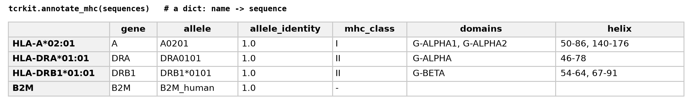

# tcrkit

Turn TCR and pMHC data as it is reported (gene calls, CDR3s, allele names) into clean,
full-length, IMGT-numbered sequences, and describe them in one consistent way. Use it as a
Python library or from the command line.

## What is it for?

Every dataset writes TCRs and MHCs its own way: `TCRBV20S1` or `TRBV20-1`, a CDR3 with or
without its C/F, `HLA-A*02:01` or `A*0201`, and usually no sequence at all. tcrkit gets
them all into one form:

* **Build sequences from gene calls.** V + J + CDR3 → the full-length chain, and an
  allele name → the MHC protein, ready for structure prediction or language models.
* **Clean up a TCR–pMHC table.** One call normalizes the names, repairs the CDR3s,
  stitches both chains and fetches the MHC, and checks its own work
  ([`build_tcr_pmhc`](#the-whole-complex-in-one-call)).
* **Find the same region in any sequence.** CDR1–3 of a TCR and the groove helices of an
  MHC by IMGT position, so a residue number means the same place in every chain.
* **Compare repertoires.** Diversity, overlap, generation probability and tcrdist.

## What it covers

| function | what it does | backend |
|---|---|---|
| `stitch`, `stitch_pair` | V/J calls + CDR3 → full-length TCR chain | [Stitchr](https://jamieheather.github.io/stitchr/) |
| `add_cdr3_junctions` | put the conserved C104 / F118 back on a CDR3 | bundled table |
| `anarci` | TCR sequence → chain type, V/J genes, CDR1/2/3, IMGT numbering; per residue, which part is V / J / C | [ANARCI](https://github.com/oxpig/ANARCI) + IMGT C-DOMAIN |
| `normalize_tcr`, `normalize_mhc` | messy gene / allele names → IMGT / standard form | [tidytcells](https://tidytcells.readthedocs.io/), [mhcgnomes](https://github.com/pirl-unc/mhcgnomes) |
| `mhc_sequence`, `list_mhc` | MHC allele → protein sequence, whole or by membrane region | bundled UniProt table |
| `annotate_mhc` | MHC sequence → gene, closest allele, IMGT G-domain numbering, groove helices; with `domains=True` also α3 / β2 / B2M (IMGT C-like) | bundled table + IMGT G-DOMAIN |
| `imgt_regions`, `print_residues` | the IMGT ranges of CDRs and helices; a sequence printed with its annotation | IMGT |
| `build_tcr_pmhc` | a table of TCR pairs + MHC → the whole complex, self-checked | all of the above |
| `diversity`, `morisita_horn`, `generation_probability`, `tcrdist` | repertoire metrics | scikit-bio, OLGA, tcrdist3 |

**Where it fits.** Stitchr builds chains, ANARCI numbers V domains, mhcgnomes parses
allele names; tcrkit runs them behind one interface and adds the MHC side. It works on
**sequences and tables**. To make TCR–pMHC **structure files** consistent (chain IDs,
renumbering PDB/mmCIF), use [imm-tools](https://github.com/X-lab-3D/imm-tools); both use
IMGT numbering, so their positions agree.

## Install

```bash
pip install git+https://github.com/akdslab/tcrkit.git
pip install 'tcrkit[metrics] @ git+https://github.com/akdslab/tcrkit.git'   # with the metrics

stitchrdl -s human        # once per environment, for stitch (add -s mouse if needed)
```

Everything else ships with the package, including the MHC sequences.

## A quick tour

**Every function works the same way.** It takes one value or many (a list, dict or
DataFrame) and returns a DataFrame with your input echoed beside the result. A bad row gets
a message in the `error` column instead of stopping the run. `col_mapping=` says where
your columns are (nothing is guessed from their names), and `squeeze=True` gives back the
bare value for a single input.

**Clean up names**

```python
import tcrkit

tcrkit.normalize_tcr(['TCRBV20S1', 'TRAV1-2*01'])[['symbol', 'standardized']]
#        symbol standardized
# 0   TCRBV20S1     TRBV20-1
# 1  TRAV1-2*01   TRAV1-2*01

tcrkit.normalize_mhc(['HLA-A*02:01', 'A*0201', 'H2-Kb'])[['allele_input', 'allele', 'gene']]
#   allele_input allele gene
# 0  HLA-A*02:01  A0201    A
# 1       A*0201  A0201    A
# 2        H2-Kb  H2-Kb    K
```

**Build a TCR chain.** A CDR3 reported without its C/F won't stitch, so restore it first:

```python
tcrkit.add_cdr3_junctions('ASSIRSSYEQY', 'TRBJ2-7', squeeze=True)    # 'CASSIRSSYEQYF'

beta = tcrkit.stitch('TRBV19', 'TRBJ2-7', 'CASSIRSSYEQYF', chain='beta', squeeze=True)
beta['sequence_aa']          # 'MSNQVLCCVVLCFLGANTVD...'   (include_nt=True: also sequence_nt)
```

**Number it.** If you are looking for alpha/beta chains, pass `allow={'A', 'B'}`.
Otherwise an alpha chain can come back as delta, with a TRDJ gene and no error:

```python
tcrkit.anarci(beta['sequence_aa'], allow={'A', 'B'})
#   chain_type     v_gene      j_gene CDR1_aa CDR2_aa      CDR3_aa  ...
# 0          B  TRBV19*01  TRBJ2-7*01   LNHDA  SQIVND  ASSIRSSYEQY  ...

# the whole chain in pieces: leader, V, N/D, J, constant domain, tail
tcrkit.anarci(beta['sequence_aa'], allow={'A', 'B'}, collapse='gene_segment', domains=True)

# print the sequence with its V / J / C and CDR lines under it
tcrkit.anarci(beta['sequence_aa'], allow={'A', 'B'}, domains=True, show=True)
```

**Get an MHC sequence and annotate it**

```python
a2 = tcrkit.mhc_sequence('HLA-A*02:01', squeeze=True)['sequence']   # extracellular part
tcrkit.annotate_mhc(a2)[['gene', 'allele', 'allele_identity', 'domains', 'helix']]
#   gene allele  allele_identity             domains           helix
# 0    A  A0201              1.0  G-ALPHA1, G-ALPHA2  50-86, 140-176

tcrkit.annotate_mhc(a2, collapse=True)     # strands A-D, turns and helix, with IMGT ranges
tcrkit.print_residues(tcrkit.annotate_mhc(a2, per_residue=True), color=True)
```



Trust the `gene`; treat the `allele` as approximate. It is the closest of the 184 bundled
alleles, and `allele_identity` below 1.0 means yours is not among them.

**Which IMGT positions are the CDRs and helices?**

```python
tcrkit.imgt_regions()        # CDR1-3, and the helix of each MHC groove domain, with sources
```

### The whole complex in one call

`build_tcr_pmhc` takes a table of TCR pairs and their MHC alleles. It normalizes the names,
restores the junctions, stitches both chains and fetches the MHC sequences. Then it checks
itself: ANARCI re-reads each stitched chain and must recover the CDR3 that went in.

```python
out = tcrkit.build_tcr_pmhc(df)      # columns alpha_v, alpha_j, alpha_cdr3, beta_..., mhc_a
out[out.ok]                          # the rows that came through clean
```

### Repertoire metrics

```python
tcrkit.diversity(df, by='sample', col_mapping={'clone': 'cdr3'})       # entropy, clonality, ...
tcrkit.morisita_horn(df, by='sample', col_mapping={'clone': 'cdr3'})   # overlap matrix
tcrkit.generation_probability('CASSIRSSYEQYF', 'TRBV19', 'TRBJ2-7')    # OLGA pgen
tcrkit.tcrdist(df, chains=('alpha', 'beta'))                           # distance matrix
```

### Command line

Every capability except `mhc_sequence`, `build_tcr_pmhc` and `tcrdist` is a subcommand.
Each takes values as flags, or a table with `--in-csv`:

```bash
tcrkit stitch --v TRBV19 --j TRBJ2-7 --cdr3 CASSIRSSYEQYF --chain beta
tcrkit anarci --in-csv tcrs.csv --seq-col sequence_aa --allow A B --out-csv numbered.csv
tcrkit diversity --in-csv reps.csv --clone-col cdr3 --by sample
tcrkit --help
```

## Learn more

* [docs/api.md](docs/api.md): every function and option.
* [notebooks/tcrkit_showcase.ipynb](notebooks/tcrkit_showcase.ipynb): a runnable tour.
  [notebooks/tcrkit_metrics.ipynb](notebooks/tcrkit_metrics.ipynb) covers the metrics.
* MHC sequences can also come from DecoderTCR's HLA reference:
  `mhc_sequence(..., source='decodertcr')`, fetched once and cached. A region means the
  same stretch of the chain with either source.

## Data sources — please cite

The code is MIT, but the bundled data is other people's work:

| data | used by | cite |
|---|---|---|
| MHC protein sequences | `mhc_sequence`, `annotate_mhc`, `build_tcr_pmhc` | **[UniProt](https://www.uniprot.org)** (UniProtKB and UniParc, [CC BY 4.0](https://www.uniprot.org/help/license)) — The UniProt Consortium. UniProt: the Universal Protein Knowledgebase in 2025. *Nucleic Acids Research* 53, D609–D617 (2025) |
| HLA sequences, opt-in, not shipped | `mhc_sequence(source='decodertcr')` | **[DecoderTCR](https://github.com/Biohub/DecoderTCR)** (MIT), fetched at commit `3e3d9889` on first use — Lai B et al. DecoderTCR: Compositional Pretraining and Entropy-Guided Decoding for TCR-pMHC Interactions. *ICML* (2026). |
| membrane topology of those sequences | `mhc_sequence(region=...)`, `annotate_mhc` | **DeepTMHMM** — Hallgren, J. et al. DeepTMHMM predicts alpha and beta transmembrane proteins using deep neural networks. *bioRxiv* (2022). [doi:10.1101/2022.04.08.487609](https://doi.org/10.1101/2022.04.08.487609) |
| IMGT C-domain numbering (TCR constant domain, MHC α3 / β2, B2M) | `anarci(domains=True)`, `annotate_mhc(domains=True)` | **IMGT** (CC BY 4.0) — Lefranc, M.-P. et al. IMGT unique numbering for immunoglobulin and T cell receptor constant domains and Ig superfamily C-like domains. *Dev. Comp. Immunol.* 29, 185–203 (2005) |
| IMGT G-domain numbering, and the groove helices | `annotate_mhc`, `imgt_regions` | **IMGT** (CC BY 4.0) — Lefranc, M.-P. et al. IMGT unique numbering for the G-DOMAIN and G-LIKE-DOMAIN. *Dev. Comp. Immunol.* 29, 917–938 (2005). Helix ranges from the [MHC Motif Atlas](http://mhcmotifatlas.org) |
| CDR3 junction residues per V/J gene | `add_cdr3_junctions` | **OTS** (CC BY 4.0; per-gene aggregates only) — Raybould, M.I.J. et al. The Observed T Cell Receptor Space database. *Cell Reports* 43(9):114704 (2024). [doi:10.1016/j.celrep.2024.114704](https://doi.org/10.1016/j.celrep.2024.114704) |

Per-file provenance is in [the data README](src/tcrkit/data/README.md).

## License

[MIT](LICENSE). The bundled data keeps its own terms, above.

Written and maintained by Ali Davari.

## Development

```bash
git clone https://github.com/akdslab/tcrkit.git && cd tcrkit
uv sync --extra dev --extra metrics       # or: pip install -e '.[dev,metrics]'
uv run pytest
uv run jupyter nbconvert --to notebook --execute --inplace notebooks/tcrkit_showcase.ipynb
```

The showcase notebook doubles as an integration test: it fails loudly if any capability
has regressed.
