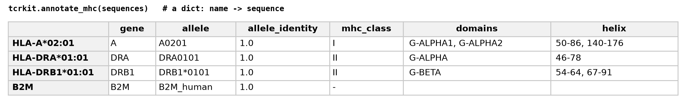

# tcrkit

Build full-length TCR sequences from V/J gene calls and a CDR3, number them in the IMGT
scheme, number MHC chains the same way and find their gene, and standardize messy gene
and allele names. Use it as a Python library or from the
command line.

| Capability               | What it does                                          | Backend                                            |
| ------------------------ | ----------------------------------------------------- | -------------------------------------------------- |
| `stitch`                 | V/J calls + CDR3 → full-length TCR nt/aa sequence     | [Stitchr](https://jamieheather.github.io/stitchr/) |
| `anarci`                 | protein sequence → V/J genes and CDR1/2/3             | [ANARCI](https://github.com/oxpig/ANARCI)          |
| `add_cdr3_junctions`     | put the conserved C104 / F118 back on a CDR3          | bundled table                                      |
| `normalize_tcr`          | TCR gene/allele names → IMGT                          | [tidytcells](https://tidytcells.readthedocs.io/)   |
| `normalize_mhc`          | HLA/MHC allele names → standard form                  | [mhcgnomes](https://github.com/pirl-unc/mhcgnomes) |
| `mhc_sequence`           | MHC allele → protein sequence                         | bundled table                                      |
| `annotate_mhc`           | MHC chain → gene, IMGT numbering, groove helices      | bundled table + IMGT G-DOMAIN                      |
| `imgt_regions`           | the IMGT ranges behind those labels, with sources     | IMGT                                               |
| `build_tcr_pmhc`         | a table of TCR pairs + MHC → the whole complex        | all of the above                                   |
| `diversity`, `morisita_horn`, `generation_probability`, `tcrdist` | repertoire metrics | scikit-bio, OLGA, tcrdist3 |

Every function works the same way: it takes one value or many (a list, dict or
DataFrame), returns a DataFrame with your input echoed beside the result, and reports a
bad row in an `error` column instead of raising. `col_mapping=` says where your columns
are; nothing is guessed from column names.

**Learn more:** [docs/api.md](docs/api.md) has every function and option.
[notebooks/tcrkit_showcase.ipynb](notebooks/tcrkit_showcase.ipynb) is a runnable tour, and
[notebooks/tcrkit_metrics.ipynb](notebooks/tcrkit_metrics.ipynb) covers the metrics.

## Install

```bash
pip install git+https://github.com/akdslab/tcrkit.git
pip install 'tcrkit[metrics] @ git+https://github.com/akdslab/tcrkit.git'   # with the metrics

stitchrdl -s human        # once per environment, for stitch (add -s mouse if needed)
```

Everything else ships with the package, including the MHC sequences (from UniProt).
`mhc_sequence(..., source='decodertcr')` uses DecoderTCR's HLA reference instead, fetched
once and cached; regions mean the same stretch of the chain either way.

## A quick look

```python
import tcrkit

# a full-length chain from gene calls and a CDR3
tcrkit.stitch('TRBV19', 'TRBJ2-7', 'CASSIRSSYEQYF', chain='beta')
#         v        j           cdr3              sequence_aa  error
# 0  TRBV19  TRBJ2-7  CASSIRSSYEQYF  MSNQVLCCVVLCFLGANTVD...      -

# a CDR3 reported without its C/F will not stitch; restore it first, as its own step
tcrkit.add_cdr3_junctions('ASSIRSSYEQY', 'TRBJ2-7', squeeze=True)     # 'CASSIRSSYEQYF'

# V/J genes and CDR loops of a protein sequence
tcrkit.anarci(beta_seq, allow={'A', 'B'})
#   chain_type      v_gene      j_gene    CDR3_aa  error
# 0          B  TRBV6-2*01  TRBJ2-3*01  ASSFTDTQY      -

# messy names
tcrkit.normalize_tcr('TCRBV20S1', squeeze=True)                       # 'TRBV20-1'
tcrkit.normalize_mhc('A*0201', squeeze=True)['allele']                # 'A0201'
```

> **If you are looking for alpha/beta chains, pass `allow={'A', 'B'}` to `anarci`.**
> Without it, ANARCI picks among every chain type it knows. Alpha and delta overlap, so
> an alpha chain can come back as delta with a TRDJ gene and no error. Leave `allow` out
> only if you want ANARCI to decide the chain type.

### MHC chains

`annotate_mhc` is the MHC counterpart of `anarci`:



Trust the `gene`; treat the `allele` as approximate. It is the closest of the 184
bundled alleles, and `allele_identity` below 1.0 means yours is not among them.

### The whole complex in one call

`build_tcr_pmhc` takes a table of TCR pairs and their MHC alleles. It normalizes the
names, restores the junctions, stitches both chains and fetches the MHC sequences. Then
it checks itself: ANARCI re-reads each stitched chain and must recover the CDR3 that went in.

```python
out = tcrkit.build_tcr_pmhc(df)      # columns alpha_v, alpha_j, alpha_cdr3, beta_..., mhc_a
out[out.ok]                          # the rows that came through clean
```

### Repertoire metrics

```python
tcrkit.diversity(df, by='sample', col_mapping={'clone': 'cdr3'})    # entropy, clonality, ...
tcrkit.morisita_horn(df, by='sample', col_mapping={'clone': 'cdr3'})   # overlap matrix
tcrkit.generation_probability('CASSIRSSYEQYF', 'TRBV19', 'TRBJ2-7')    # OLGA pgen
tcrkit.tcrdist(df, chains=('alpha', 'beta'))                           # distance matrix
```

## Command line

Every capability except `mhc_sequence`, `build_tcr_pmhc` and `tcrdist` is a subcommand.
Each takes values as flags or a table with `--in-csv`:

```bash
tcrkit stitch --v TRBV19 --j TRBJ2-7 --cdr3 CASSIRSSYEQYF --chain beta
tcrkit anarci --in-csv tcrs.csv --seq-col sequence_aa --allow A B --out-csv numbered.csv
tcrkit diversity --in-csv reps.csv --clone-col cdr3 --by sample
tcrkit --help
```

## Data sources — please cite

The code is MIT, but the bundled data is other people's work:

| data | used by | cite |
|---|---|---|
| MHC protein sequences | `mhc_sequence`, `annotate_mhc`, `build_tcr_pmhc` | **[UniProt](https://www.uniprot.org)** (UniProtKB and UniParc, [CC BY 4.0](https://www.uniprot.org/help/license)) — The UniProt Consortium. UniProt: the Universal Protein Knowledgebase in 2025. *Nucleic Acids Research* 53, D609–D617 (2025) |
| HLA sequences, opt-in, not shipped | `mhc_sequence(source='decodertcr')` | **[DecoderTCR](https://github.com/Biohub/DecoderTCR)** (MIT), fetched at commit `3e3d9889` on first use — Lai B et al. DecoderTCR: Compositional Pretraining and Entropy-Guided Decoding for TCR-pMHC Interactions. *ICML* (2026). |
| membrane topology of those sequences | `mhc_sequence(region=...)`, `annotate_mhc` | **DeepTMHMM** — Hallgren, J. et al. DeepTMHMM predicts alpha and beta transmembrane proteins using deep neural networks. *bioRxiv* (2022). [doi:10.1101/2022.04.08.487609](https://doi.org/10.1101/2022.04.08.487609) |
| IMGT G-domain numbering, and the groove helices | `annotate_mhc` | **IMGT** (CC BY 4.0) — Lefranc, M.-P. et al. IMGT unique numbering for the G-DOMAIN and G-LIKE-DOMAIN. *Dev. Comp. Immunol.* 29, 917–938 (2005). Helix ranges from the [MHC Motif Atlas](http://mhcmotifatlas.org) |
| CDR3 junction residues per V/J gene | `add_cdr3_junctions` | **OTS** (CC BY 4.0; per-gene aggregates only) — Raybould, M.I.J. et al. The Observed T Cell Receptor Space database. *Cell Reports* 43(9):114704 (2024). [doi:10.1016/j.celrep.2024.114704](https://doi.org/10.1016/j.celrep.2024.114704) |

Per-file provenance is in [the data README](src/tcrkit/data/README.md).

## License

[MIT](LICENSE). The bundled data keeps its own terms, above.

Written and maintained by Ali Davari.

## Development

```bash
git clone https://github.com/akdslab/tcrkit.git && cd tcrkit
uv sync --extra dev --extra metrics       # or: pip install -e '.[dev,metrics]'
uv run pytest
uv run jupyter nbconvert --to notebook --execute --inplace notebooks/tcrkit_showcase.ipynb
```

The showcase notebook doubles as an integration test: it fails loudly if any capability
has regressed.
