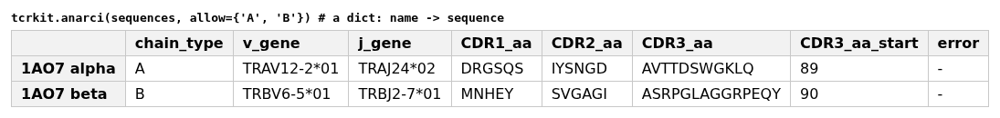
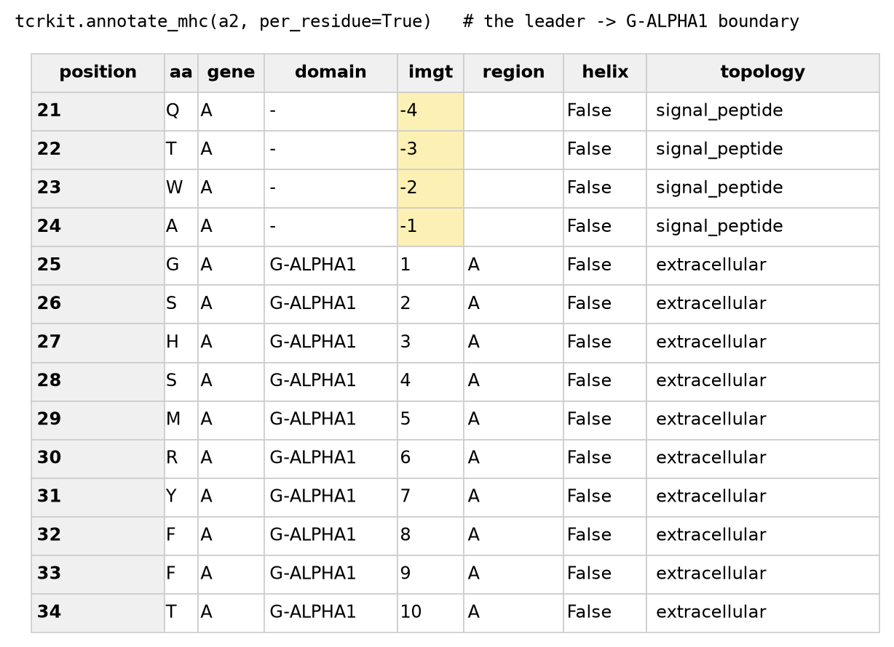

# tcrkit API reference

Every public function in one place. All of them follow the same rules, so read this once:

- **Any input shape.** A single value, a list, a Series, a dict, a list of records, or a
  DataFrame. The function works out which you gave it.
- **A DataFrame out**, indexed like the input, with your input echoed back beside the
  result — so `df['x'] = tcrkit.f(df)['x']` always aligns. `squeeze=True` returns the bare
  value instead: a scalar for one input and one result column, the row as a Series for
  one input and several columns (`r['sequence']` or `r.sequence`), a Series for many
  inputs and one column.
- **`col_mapping=`** says where your columns live, e.g. `{'cdr3': 'junction_aa'}`. Nothing
  is guessed from column names. Where a function handles more than one chain, the keys are
  prefixed: `alpha_v`, `beta_cdr3`, `mhc_a`.
- **One `error` column** in every frame — empty when the row is fine, the reason when it
  is not. Bad rows are reported, not raised.
- **Species are `human` or `mouse`**, in and out. `Mus musculus`, `homoSapiens`, `MOUSE`
  are all understood. An unrecognised species in a *keyword* raises; one in *your own data
  column* falls back instead of aborting the call.
- **Per-row keywords.** `chain`, `species` and `constant` each take one value for the whole
  input, one per row, or come from a column of that name in your input.
- **`progress_bar=`** (on `stitch`, `anarci`, `build_tcr_pmhc`) shows a tqdm bar for more
  than a few rows; pass `False` in scripts and notebooks. **`mute=True`** (on `stitch` and
  `anarci`, the default) keeps the wrapped tool's own stdout/stderr quiet.

```python
import tcrkit
```

---

## 1. Sequence building

### `stitch(v, j, cdr3, chain=None, species=None, ...)`

Builds a full-length TCR chain from gene calls and a CDR3, via Stitchr.

| argument | meaning |
|---|---|
| `v`, `j`, `cdr3` | the rearrangement. `v` alone may be the whole input (a frame or records) |
| `chain` | `'alpha'` / `'beta'` / `'gamma'` / `'delta'`. **Not inferred from the V gene** — without it everything is treated as beta |
| `species` | `'human'` (default) or `'mouse'`. Needs `stitchrdl -s <species>` run once |
| `constant` | `None` → `DEFAULT_CONSTANT` (this package's fixed per-chain convention); `'auto'` → Stitchr's J-gene-aware rule; an allele name such as `'TRBC2*01'`; or `{'beta': 'TRBC2*01'}` per chain. `'constant'` / `'default'` are synonyms for `None` |
| `no_leader` | drop the leader sequence from the output |
| `run_anarci` | also annotate each stitched sequence with ANARCI, adding `anarci_cols` |
| `engine` | `'stitchr'` (a Python call per row) or `'thimble'` (one CLI run for the whole input) |
| `max_workers` | fan rows out over this many processes |
| `batch_size` | rows per chunk when `max_workers` > 1 (default 500) |
| `anarci_cols` · `anarci_kwargs` | which ANARCI columns `run_anarci` keeps (`None` keeps all), and extra arguments for that pass, e.g. `{'allow': {'A', 'B'}}` |
| `**engine_kwargs` | passed to the engine, e.g. `thimble_bin=`, `extra_genes=`, `seamless=` for `engine='thimble'` |

Out: `v` / `j` / `cdr3` echoed, `sequence` (nucleotide), `sequence_aa`, `error`, and
`stitchr_warnings` (Stitchr's own remarks, e.g. which allele it defaulted to).

A CDR3 without its conserved C104/F118 will **not** stitch — it says `Unable to locate C
terminus of CDR3`. Repair it first with `add_cdr3_junctions`; `stitch` never repairs.

### `stitch_pair(df, col_mapping, chains=('alpha','beta'), ...)`

Both chains of a receptor from one row, in a single `thimble` subprocess — the one thing
`stitch` (one chain at a time) cannot express. `col_mapping` is required and prefixed:
`{'alpha_v': 'a_v', 'beta_cdr3': 'b_cdr3', ...}`. A chain whose columns are absent is left
blank. `chains` is `('alpha','beta')` or `('gamma','delta')`; the two cannot be mixed.

| argument | meaning |
|---|---|
| `species`, `constant` | as `stitch` |
| `leader` | thimble's `{locus}_leader` column — a string, or a dict per chain. `None` uses the V gene's own leader. Stitchr takes a *DNA* leader verbatim, so `leader='NNN'` gives a 3-nt placeholder: drop 1 aa and you have what `stitch(no_leader=True)` produces. It also rescues V genes with no leader in IMGT. Keep the length a multiple of 3 |
| `extra_genes`, `seamless` | thimble's `-xg` / `-sl` |
| `extra_args` | anything else for the thimble command line, e.g. `('-p', 'preferred_alleles.tsv')` |
| `thimble_bin` | path to the `thimble` executable, if it is not on PATH |
| `in_file`, `out_file`, `work_dir`, `keep_files` | the TSVs thimble reads and writes live in a temp dir that is deleted afterwards — unless you name one (`in_file` / `out_file`, then kept), choose the dir (`work_dir`), or keep it all (`keep_files=True`, prints the paths) |
| `verbose` | print the command and thimble's output |

### `DEFAULT_CONSTANT`

`{'alpha': 'TRAC*01', 'beta': 'TRBC1*01', 'gamma': 'TRGC1*01', 'delta': 'TRDC*01'}` — what
`constant=None` uses. Differs from Stitchr's `'auto'` for TRBJ2 rearrangements, which get
`TRBC2*01` there and `TRBC1*01` here: a 2-residue difference in the final protein.

---

## 2. Numbering and annotation

### `anarci(sequences, allow=..., ...)`

IMGT-numbers protein sequences and reports their V/J genes and CDR loops.

| argument | meaning |
|---|---|
| `sequences` | one amino-acid sequence or any collection. A dict names them, and the names become the index |
| `allow` | limit ANARCI to these chain types — `{'A','B'}` when you are looking for alpha/beta chains, `{'G','D'}` for gamma/delta. Leave it out to let ANARCI choose among all chain types |
| `include_imgt_index` | add an `imgt_dict` column of IMGT position → residue |
| `separate_index` | spread that into one column per IMGT position, with `_position` / `_suffix` header rows, so several chains line up on shared columns |
| `raise_error` | raise instead of returning an error row for a sequence that will not number |
| `per_residue` | one row per residue instead: `position`, `aa`, `chain_type`, `imgt` (`'-'` outside the V domain), `region` (`FR1`, `CDR1`, … `FR4`; `''` outside) |
| `collapse` | one row per segment instead: `collapse='region'` (or `True`) gives FR1, CDR1, … FR4, each with `start` / `end` (1-based), `length`, `imgt_start` / `imgt_end` and `sequence` |
| `use_pyhmmer` | force the in-process pyhmmer backend on (`True`) or off (`False`); `None` (default) uses it only when no `hmmscan` binary is on PATH. Only the process's first call decides. The `ANARCI_USE_PYHMMER=1`/`0` environment variable does the same |
| `**anarci_kwargs` | anything else goes to ANARCI's `run_anarci` — `allow` itself, `scheme=`, `assign_germline=`, `ncpu=` |



Out: `CDR1/2/3_aa` with their 1-based `_start` / `_end`, `v_gene` / `j_gene` and their
identities, `species`, `chain_type`, `query_start` / `query_end`, `error`.

> **If you are looking for alpha/beta chains, pass `allow={'A','B'}`.** The alpha and delta
> loci overlap, so an unrestricted alpha chain can come back as `chain_type` `D` with a
> `TRDJ` gene, with no error. You don't need `allow` if you want ANARCI to pick the chain
> type itself (gamma/delta, or antibody chains too). Just check any `D` calls.

`CDR3_aa` is IMGT 105–117, so it carries no C104/F118.

### `CDR_IMGT_LOCS`

`{'cdr1': (27, 38), 'cdr2': (56, 65), 'cdr3': (105, 117)}` — the IMGT spans the CDR columns
are cut from.

### `read_sequences(path)`

One sequence per line from a plain-text or FASTA file → `[(id, seq), ...]`. FASTA headers
become ids; unlabelled lines get `id_1`, `id_2`, …

---

## 3. Names and alleles

### `normalize_tcr(symbols, species=None, with_gene=False, ...)`

TCR gene and allele symbols → IMGT nomenclature, via tidytcells.

`species` may be `'human'`, `'mouse'`, `'any'` (try both and report which won), a sequence
with one entry per symbol, or left unset — then your own `species` column is used if there
is one, else `'any'`. `with_gene=True` also reports the symbol truncated to the gene, at
the cost of one extra tidytcells call per row. Other keywords go to
`tidytcells.tr.standardize` — e.g. `precision='gene'`, `on_fail='keep'`,
`log_failures=False` (silences its warnings for symbols it cannot resolve).

Out: `symbol`, `standardized`, `species`, `error`. Unresolvable symbols come back empty.

> **A valid but wrong species changes the gene silently.** `normalize_tcr('TRBV20-1',
> species='mouse')` returns `'TRBV20'` — a different gene, no error. Leave `species` unset,
> or compare `standardized` against `symbol`.

### `to_gene(symbols, species=None)`

`normalize_tcr` truncated to the gene: `TRBV20-1*01` → `TRBV20-1`. Keeps the input on
failure. Extra keywords go to `normalize_tcr`.

### `genes_match(gene, symbol) -> bool`

True if two calls mean the same gene, tolerating allele suffixes, IMGT's TRAV/DV dual
naming and subgroup differences. A plain predicate — returns a bool, not a frame.

### `normalize_mhc(alleles, paired=False, errors='raise', ...)`

HLA/MHC allele names → canonical form, via mhcgnomes.

| argument | meaning |
|---|---|
| `alleles` | an allele name, an explicit `"alpha__beta"` pair, or any collection |
| `paired` | return the `mhc_a_*` / `mhc_b_*` layout for **every** class, inferring the partner: DRB* with DRA0101, a class-I heavy chain with its invariant B2M. Implies `unified` |
| `chain` | `'alpha'` or `'beta'` — pick one chain of a native pair when `paired=False` |
| `errors` | `'raise'` (default) or `'coerce'` / `'ignore'`, which record the reason in `error` so one bad allele cannot abort a batch |
| `unified` | express single alleles in the paired layout without inferring a class-II partner; `paired=True` turns this on |
| `enforce_one_allele` | raise if a string resolves to more than one allele |
| `**kwargs` | forwarded per allele: `restrict_allele_fields` (fields to keep — 2 gives `A*02:01`), `drop_mutations`, `fix_chain_order` |

Out: `allele_input` (your input echoed), `mhc_prefix`, `species`, `gene`, `allele`,
`mhc_class`, `chain_order_swapped`, `error`.

### `mhc_chain_of(allele) -> 'alpha' | 'beta' | None`

Which chain a single allele is. Class I: heavy chain → `'alpha'`, B2M → `'beta'`. Class II:
by the gene letter, `DRA` → `'alpha'`, `DRB1` → `'beta'`.

---

## 4. CDR3 junctions

### `add_cdr3_junctions(cdr3, j, v=None, species=None, keep_unknown=False, ...)`

Puts the IMGT junction residues (104 `C` … 118 `F`/`W`/`C`/`L`/`V`) back on a CDR3 reported
as 105–117 only — the step that makes a CDR3 stitchable.

Only `cdr3` and `j` are required: the **J gene determines the 118 residue** (`TRBJ1-1` ends
in F, `TRAJ33` in W, `TRAJ35` in C), which is why this is table-driven rather than a blind
`'C' + cdr3 + 'F'`. `v` and `species` only make the match more specific.
`keep_unknown=True` keeps the original where the genes are unknown, instead of leaving
`cdr3_fixed` empty. `table=` takes your own lookup.

Out: `cdr3_fixed`, `changed`, plus the lookup's reasoning — `junction`, `purity` (share of
reference rows agreeing), `n` (rows behind it) and `level` (`'V+J'`, `'J'` or
`'J/any-species'`, tried in that order).

### `junction_of(j, v=None, species=None, ...)`

Just the junction a gene pair uses — `'C/F'`, `'C/W'` — with the same `purity` / `n` /
`level` columns. `squeeze=True` gives the string.

### `load_junction_table(path=None)` · `build_junction_table(ref, cdr3_col, j_col, v_col=None, species_col=None, path=None)`

Read the bundled table (cached per session), or learn one from your own reference data,
which must report CDR3s **with** their junction residues. Pass the result back as `table=`.
Without `v_col` the `V+J` level is empty and only J-level lookups hit.

---

## 5. MHC sequences and structure

### `mhc_sequence(alleles, paired=False, region='extracellular', mark_regions=False, table=None, source=None, ...)`

An allele → its protein sequence. The allele is normalized first, so `'HLA-A*02:01'`,
`'A*0201'` and `'A0201'` all find the same row. `paired=True` returns both chains of the
heterodimer.

`region=` picks which part of the chain you get, cut from the membrane topology stored
alongside each sequence:

| `region` | gives | synonyms |
|---|---|---|
| `'extracellular'` | **default** — the ectodomain: past the signal peptide, before the membrane | `ectodomain`, `outside` |
| `'full'` | the precursor as deposited | `precursor` |
| `'mature'` | the chain after its signal peptide is cleaved | |
| `'signal_peptide'` | the cleaved N-terminal leader | `signal`, `leader` |
| `'transmembrane'` | the membrane-spanning helix | `tm`, `tmhelix` |
| `'cytoplasmic'` | the intracellular tail | `intracellular`, `inside`, `tail` |

`regions` names what the returned sequence contains, and the four region columns give
their ranges — renumbered from 1 inside that sequence, empty for anything it does not
contain:

```python
tcrkit.mhc_sequence('A0101', region='full')
#  allele  length                                                   regions  signal_peptide  extracellular  transmembrane  cytoplasmic
#   A0101     365  signal_peptide, extracellular, transmembrane, cytoplasmic            1-24         25-307        308-332      333-365

tcrkit.mhc_sequence('A0101')                 # the default: the ectodomain only
#  allele  length        regions  signal_peptide  extracellular  transmembrane  cytoplasmic
#   A0101     283  extracellular            None          1-283           None         None
```

`mark_regions=True` adds `topology_seq`: a string exactly as long as `sequence`, one
letter per residue, in DeepTMHMM's alphabet — `S` signal peptide, `O` extracellular,
`M` transmembrane, `I` cytoplasmic, `-` unknown.

```python
out = tcrkit.mhc_sequence('A0101', region='full', mark_regions=True).iloc[0]
out.sequence      # 'MAVMAPRTLLLLLSGALALTQTWAGSHSMRYFFT...SSQPTIPIVGIIAGLVLLGA...'
out.topology_seq  # 'SSSSSSSSSSSSSSSSSSSSSSSSOOOOOOOOOO...OOOOOOOMMMMMMMMMMMMM...'
```

Extra keywords go to `normalize_mhc` (e.g. `restrict_allele_fields=`).

#### Where the sequences come from

| `source=` | what | |
|---|---|---|
| `'uniprot'` (default) | the bundled reference: 186 alleles, each with its own UniProt entry, identical to the allele | shipped |
| `'decodertcr'` | [DecoderTCR](https://github.com/Biohub/DecoderTCR)'s HLA reference (MIT): 87 human chains from its 88 pairs | downloaded on first use, then cached in `~/.cache/tcrkit/` |

```python
tcrkit.mhc_sequence('HLA-A*02:01')                          # bundled
tcrkit.mhc_sequence('HLA-A*02:01', source='decodertcr')     # DecoderTCR
tcrkit.mhc_sequence('DRB1*01:01', source='decodertcr')      # one chain of a DecoderTCR pair
tcrkit.mhc_sequence('DRA*01:02__DRB1*01:01', paired=True, source='decodertcr')
```

**A region means the same thing whichever source it comes from.** DecoderTCR's
sequences are mature chains with no topology of their own, so each is annotated against
the bundled reference and gets the matched allele's signal peptide / extracellular /
transmembrane / cytoplasmic spans by alignment. `region='extracellular'` therefore cuts
the same stretch of the chain from either source, and `annotate_mhc` gives both the
same IMGT numbering. DecoderTCR stores pairs; tcrkit splits them into single chains, so a
chain can be asked for on its own or as a pair (`pairs` lists the DecoderTCR keys).

Pass `table=` to use your own reference instead — a DataFrame or CSV path needing only
`allele` and `sequence` columns (plus topology spans if you want `region=` to cut
anything), whose allele spellings are normalized for you. `table=` and `source=` are
exclusive.

### `load_mhc_table(path=None, source='uniprot')` · `bundled_mhc_table_path()` · `MHC_SOURCES`

`load_mhc_table()` returns the whole reference as a DataFrame (cached per session), for
either source. The bundled one is two files, `mhc_uniprot.fasta` (the UniProt
sequences, exactly as UniProt serves them) and `mhc_annotations.csv` (everything else),
joined here; `bundled_mhc_table_path()` is the CSV, and passing it as `path=` gives the
same joined table. Another `path=` reads a file of the same shape. One table of 186
alleles serves both MHC capabilities: every row carries its full sequence and membrane
topology, `accession` the UniProt entry, `in_detect` marks the database MHC genes are
matched on (`best_mhc`, behind `annotate_mhc`), and `helix_ind` the Motif Atlas gene
representatives. `MHC_SOURCES` lists the sources.

### `list_mhc(what='alleles', source='uniprot')`

What a source has, for looking at: `'alleles'` (one row per allele), `'genes'` (one row
per gene, with `n_alleles` and the `alleles`), or `'pairs'` — the heterodimers DecoderTCR
stores, as `pair`, `mhc_a`, `mhc_b`, `mhc_class`. The bundled reference stores single
chains, so pairs need `source='decodertcr'`.

```python
tcrkit.list_mhc('genes')                          # bundled: 186 alleles over their genes
tcrkit.list_mhc('pairs', source='decodertcr')     # DecoderTCR's 88 pairs
```

### `region_of(row, region='extracellular')` · `REGIONS` · `TOPOLOGY` · `topology_labels(row)`

Cut one reference row down to a region, returning `(sequence, topology_spans)`; the region
names accepted; the mapping of region name → span column; and one region name per residue.
What `mhc_sequence(region=...)` uses internally. Not re-exported at the top level:
`from tcrkit.pmhc import region_of, REGIONS, TOPOLOGY, topology_labels`.

### `annotate_mhc(sequences, helix='imgt', per_residue=False, ...)`

What MHC gene a sequence is, its IMGT numbering, and where its groove helices are — the
structural counterpart to `mhc_sequence`'s lookup.

Out, one row per sequence: `gene` (`'A'`, `'DRB1'`, `'B2M'`, …), `allele` (closest bundled
allele), `allele_identity` (share of identical residues between your sequence and that
allele over the part that aligns), `mhc_class`, `score` (alignment score per residue), `span` (1-based range of the
MHC part), `domains` (the G domains found, in order) and `domain_spans`, `helix` (1-based
ranges of the groove-helix residues), `regions` and the four region columns, `error`.

The four region columns are the matched allele's membrane regions carried onto *your*
sequence by alignment, so a chain that is not exactly a bundled allele — or only a
fragment of one — still gets marked:

```python
tcrkit.annotate_mhc([a1_chain, a1_chain[:200]])
#   gene allele                                   regions signal_peptide extracellular transmembrane cytoplasmic
# 0    A  A0101  signal_peptide, extracellular, transmem...           1-24        25-307       308-332     333-365
# 1    A  A0101              signal_peptide, extracellular           1-24        25-200           NaN         NaN
```

`collapse=` turns that per-residue table into segments: one row per run of consecutive
residues sharing the given column(s), any of `domain`, `region`, `helix`, `topology`.
Each row has the column value(s), `start` / `end` (1-based), `length`, `imgt_start` /
`imgt_end` and `sequence`. Include `domain` when collapsing on `region` or `helix`, so
the runs do not cross from one G domain to the next. `collapse=True` means `['domain', 'region']`:

```python
s = tcrkit.mhc_sequence('A*02:01', region='full', squeeze=True)['sequence']
tcrkit.annotate_mhc(s, collapse='topology')               # signal peptide ... tail
tcrkit.annotate_mhc(s, collapse=['domain', 'region'])     # strands A-D, turns, helix
```

With `per_residue=True`, one row per residue instead: `position`, `aa`, `gene`, `allele`, `domain`,
`imgt` (the IMGT label), `region` (IMGT strand `A`–`D`, or `helix`), `helix` (bool) and
`topology` (`'signal_peptide'`, `'extracellular'`, `'transmembrane'`, `'cytoplasmic'`
or `'-'`).

`mark_regions=True` adds `topology_seq`, one letter per residue in the same alphabet as
`mhc_sequence` (`S` / `O` / `M` / `I` / `-`), estimated from the matched allele.

Signal-peptide residues are numbered **backwards from IMGT 1** — `-24` … `-1` — the
usual convention for leaders. Everything else outside the G domains stays `'-'`: the
C-like α3 domain, the membrane anchor and the cytoplasmic tail belong to other IMGT
schemes, and numbering them here would mix two coordinate frames in one column.

> **The allele is approximate.** Only 184 alleles are searched, so `allele` is the closest
> of those, not a typing result. `allele_identity` = 1.0 means an exact match over the
> aligned part; lower means your allele is not bundled. The gene call is reliable. Gene matching always uses the bundled reference, so a sequence from
> any source - DecoderTCR's, or your own - is annotated the same way.

`helix=` picks how helices are found:

- `'imgt'` (default): number the sequence against IMGT's G-DOMAIN templates
  (`imgt_gdomains.csv`), then mark fixed IMGT positions: 50–86 of G-ALPHA1 and G-ALPHA,
  52–86 of G-ALPHA2, 52–86 of G-BETA without 61B and 62. No helix column of the MHC
  table is read.
- `'tpm-bench'`: take the `helix_ind` ranges of the closest MHC Motif Atlas gene (the
  `helix_ref_span` / `helix_ind` columns of `mhc_annotations.csv`), mapped onto your
  sequence by alignment. A chain that starts inside a helix keeps the part of it that it
  has.

The gene, which decides which G domains are numbered, comes from the MHC table either way.



Each domain is numbered by alignment to the closest of 42 human, mouse and rat entries
from IMGT's [G-DOMAIN page](https://www.imgt.org/IMGTrepertoireMH/Proteins/protein/G-DOMAIN/Gdomains.html);
`attrs['templates']` of the per-residue table names them. That table ships with tcrkit;
`python -m tcrkit._build.fetch_imgt_gdomains` rebuilds it from IMGT.

### The gene matching: `best_mhc` · `mhc_span` · `mhc_chain` · `mhc_database` (in `tcrkit.mhc`)

What `annotate_mhc` does first, for one sequence, as plain functions:

```python
from tcrkit.mhc import best_mhc, mhc_chain, mhc_span

best_mhc(seq)                    # ('A', 'A0201', 0.53): gene, closest allele, score
mhc_span('GGGGSGGGGS' + seq)     # (10, 192): where the MHC part lies, 0-based, end exclusive
mhc_chain('DRB1')                # 'beta'
```

- `best_mhc(sequence)`: the best-matching bundled gene and allele, and the local
  alignment score divided by the longer sequence's length (`None, None, 0.0` if nothing
  matches). Cached by sequence.
- `mhc_span(sequence)`: the part of `sequence` the alignment to that allele covers, so
  tags, linkers or a fused peptide are left out. None if no MHC sequence matches.
- `mhc_chain(gene)`: which chain of an MHC molecule a gene codes for: `'heavy'`
  (class I), `'alpha'` / `'beta'` (class II), `'B2M'`, or None for an unknown gene.
  `annotate_mhc` picks the G domains to number by it. Mouse genes are named as in the
  bundled table: `AA` / `AB` for I-A alpha / beta, `EA` / `EB` for I-E.
- `mhc_database()`: the sequences matched on (the mature chains of the `in_detect`
  rows): `allele`, `sequence`, `gene`, `class`.

---

### `print_residues(residues, columns=None, width=60)`

Prints a per-residue table — from `annotate_mhc` or `anarci` with `per_residue=True` —
as the sequence on one line and each annotation on the line under it, with a position
ruler and a legend:

```python
tcrkit.print_residues(tcrkit.annotate_mhc(seq, per_residue=True))
#           1         11        21        31        41        51
# sequence  MAVMAPRTLVLLLSGALALTQTWAGSHSMRYFFTSVSRPGRGEPRFIAVGYVDDTQFVRF
# topology  SSSSSSSSSSSSSSSSSSSSSSSSOOOOOOOOOOOOOOOOOOOOOOOOOOOOOOOOOOOO
# domain                            111111111111111111111111111111111111
# region                            AAAAAAAAAAAAAA...BBBBBBBBBBB..CCCCCC
```

`columns=` picks the lines (default: whichever of `topology`, `domain`, `region`, `helix`
the table has); `SYMBOLS` says which character stands for what.

---

## 6. The whole complex

### `build_tcr_pmhc(df, col_mapping=None, species='human', run_anarci=True, mhc_table=None, keep=None)`

Runs every capability in the order they have to happen, then checks itself:

| # | step | does |
|---|---|---|
| 1 | `normalize_tcr` | V and J calls → IMGT |
| 2 | `add_cdr3_junctions` | CDR3s → with their 104 C / 118 F |
| 3 | `stitch` | V + J + CDR3 → full-length alpha and beta |
| 4 | MHC lookup | allele(s) → both chains of the heterodimer |
| 5 | `anarci` | the stitched sequences → V/J/CDR annotations |

Input columns are looked for as `alpha_v` / `alpha_j` / `alpha_cdr3`, the `beta_`
equivalents, and `mhc_a` (plus `mhc_b` for an explicit class-II pair). A chain whose columns
are absent is skipped, so single-chain tables work. Anything else you brought along — an
epitope, a study id, an affinity — is carried through untouched.

Step 5 is the self-check: ANARCI re-reads each stitched sequence knowing nothing of the
input, and its CDR3 is compared against the one that went to Stitchr → `{chain}_cdr3_ok`.
Every complaint lands in one `error` column with an `ok` flag.

`mhc_table=` supplies your own MHC sequences instead of the bundled table (same contract
as `mhc_sequence`'s `table=`). If no table can be found, the MHC sequence columns come
back empty with a warning and the rest of the build still happens. `run_anarci=False` skips step 5,
the slow one. `keep=` limits which input columns are carried through.

---

## 7. Repertoire metrics

Measures over a *set* of TCRs. Optional install: `pip install 'tcrkit[metrics]'`.

### `diversity(data, count=None, by=None, ...)`

One row per repertoire, wrapping scikit-bio. `data` may be abundances (numbers), raw clone
labels (strings, counted for you), or a DataFrame grouped by `by` — one output row per
value of that column. `count=` names the count column if it is not `count`; without one,
rows are counted.

Out: `repertoire`, `n_clones` (richness), `n_cells`, `shannon` (**bits**),
`pielou_evenness`, `clonality` (= 1 − evenness), `simpson` (1 − Σp²), `dominance` (Σp²),
`top_clone_fraction`.

`diversity` and `morisita_horn` agree with R's `vegan` to ~1e-15.

> Mind the naming: scikit-bio's `simpson` is 1 − Σp², while some immunology papers call
> `dominance` "Simpson". `shannon` in bits makes `clonality` comparable across samples of
> different richness; raw entropy is not.

### `morisita_horn(data, other=None, by=None, long=False, ...)`

Overlap between repertoires: 0 when they share no clones, 1 when identical. Abundance-
weighted and insensitive to sequencing depth, which is why it beats Jaccard for samples
sequenced to different depths.

Two repertoires: `morisita_horn(rep_a, rep_b, squeeze=True)` for the single number. Many:
`by=` gives a square symmetric matrix, or `long=True` one row per pair (`a`, `b`,
`morisita_horn`). `count=`, `by=` and `col_mapping=` work as in `diversity`.

### `generation_probability(cdr3, v=None, j=None, chain='beta', species='human', ...)`

How likely V(D)J recombination was to produce each CDR3, via OLGA. Wants the **junction**
(CDR3 with its conserved C and F) — exactly what `add_cdr3_junctions` produces. `v` and `j`
act **independently**, so passing one alone still narrows the result; without either, OLGA
marginalises over all V/J. `use_genes=False` ignores V/J even when the input carries them.

Out: `pgen`, `log10_pgen`. A CDR3 OLGA cannot parse gets pgen 0.0 and a reason in `error`.

### `tcrdist(df, chains=('beta',), species='human', long=False, **kwargs)`

Pairwise TCR distances, via tcrdist3. Per chain it needs `{chain}_cdr3` / `{chain}_v` /
`{chain}_j` — the names `build_tcr_pmhc` produces. With both chains the distance is the sum
over chains (tcrdist3's paired distance). `long=True` gives one row per pair (`i`, `j`,
`distance`) instead of a square matrix. Extra `**kwargs` go to `TCRrep`.

> tcrdist3 matches V/J at the **allele** level — `*01` is appended where your calls have
> none — and silently drops rows whose genes it cannot resolve, so check the returned shape.

---

## Command line

Nine subcommands mirror the Python API:

```
tcrkit stitch | anarci | normalize-tcr | normalize-mhc | add-cdr3-junctions
       annotate-mhc
       diversity | morisita-horn | generation-probability
```

`mhc_sequence`, `tcrdist` and `build_tcr_pmhc` are Python-only. For the metrics,
`--in-csv` takes a repertoire table with `--clone-col` (default `cdr3`), `--count-col`
(default: `count` if present, else one row per cell) and `--by` to split it into
repertoires. `diversity` also takes clone labels as arguments.
`morisita-horn --other-csv` prints the single overlap of two files.

Each takes values as flags (`tcrkit stitch --v TRBV19 --j TRBJ2-7 --cdr3 CASSIRSSYEQYF
--chain beta`) *or* a table: `--in-csv` plus the relevant `--*-col` flags, writing with
`--out-csv`, `--json`, or a readable table on stdout. `tcrkit <command> --help` lists each
command's options.
